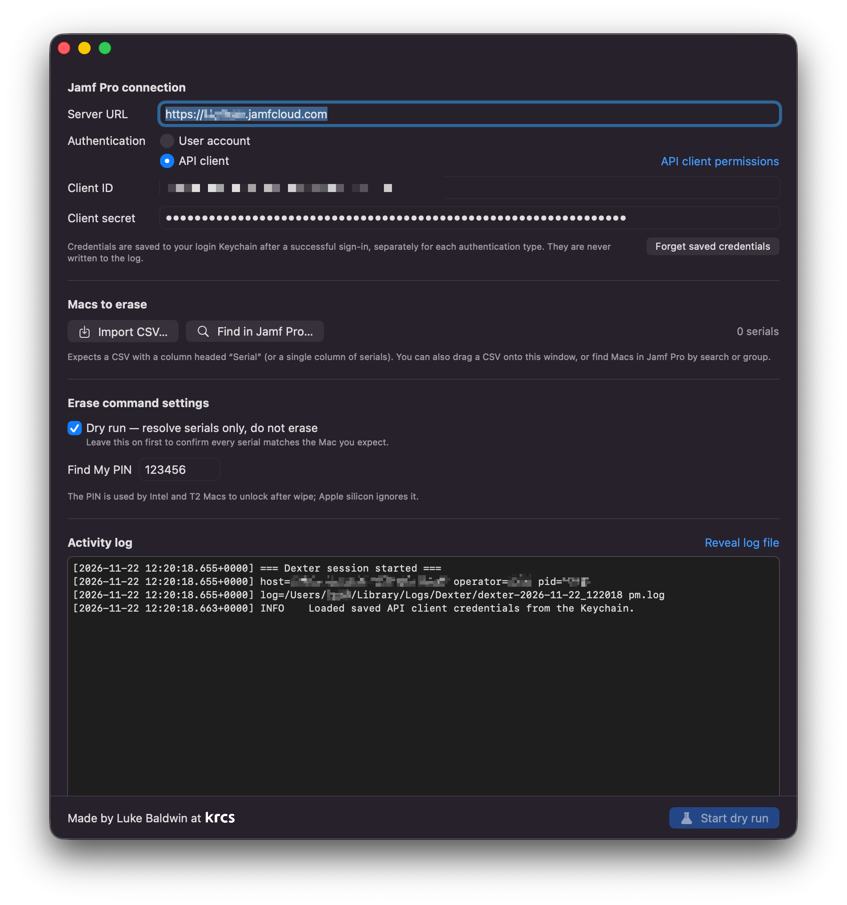
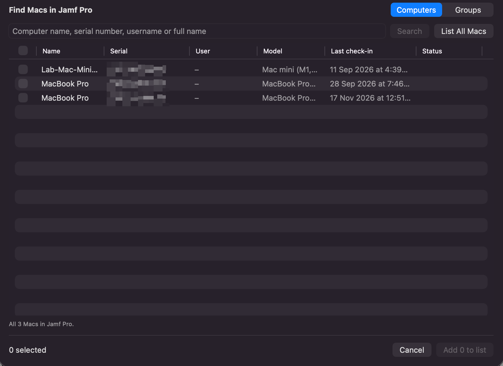
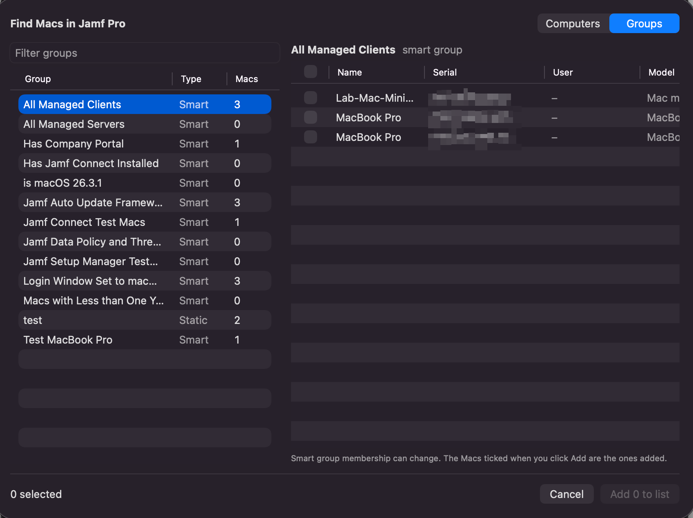

<p align="center">
  
</p>

<h1 align="center">Dexter</h1>

<p align="center">
  <strong>Erase Macs en-masse with Jamf Pro: safely, securely and with a full audit trail.</strong><br>
  A native Swift + SwiftUI macOS app for Jamf Pro administrators. 
</p>

<p align="center">
  <a href="https://github.com/ParanoidAndroid91/dexter-releases/releases/latest"><strong>⬇︎ Download the latest release</strong></a>
</p>

---

> [!WARNING]
> **Dexter sends the Erase Device command.** Erased Macs lose all of their
> data, and it can't be undone. Always run a **dry run** first and check
> every Mac in the list before sending erase commands.

## Contents

- [What Dexter does](#what-dexter-does)
- [Features](#features)
- [Requirements](#requirements)
- [Installation](#installation)
- [Setting up Jamf Pro](#setting-up-jamf-pro)
- [Using Dexter](#using-dexter)
- [Safety features](#safety-features)
- [Logs and auditing](#logs-and-auditing)
- [Updates](#updates)
- [Troubleshooting](#troubleshooting)
- [Privacy and security](#privacy-and-security)
- [Support](#support)

## What Dexter does

Born from an internal tool I made for my team at KRCS, Dexter erases multiple 
Macs at once through Jamf Pro. 

Originally named **_Serial Killer_** as it 'killed' multiple Macs using their 
_serial_ number for ID, I settled upon the more friendly name of 'Dexter' 
(if you know, you know - and if you don't, go and watch the show!).

You build a list of Macs,either from a CSV of serial numbers or by searching Jamf Pro 
and picking from computer groups (or even both together: de-duplication is built-in!). 
Dexter then checks every Mac against Jamf Pro and then sends each one the **Erase Device** 
MDM command. Every step is logged, whether it succeeds or fails, so you're kept informed.

It's designed for decommissioning or resetting a batch of Macs, without clicking through 
Jamf Pro one computer at a time. 

<p align="center">
  
</p>

## Features

### Building the list of Macs to erase
- **CSV import:** import a CSV of serial numbers with the button, File →
  Import CSV… (⌘O), or by **dragging the file onto the window**.
- **Find in Jamf Pro:** search Jamf Pro live by **computer name, serial
  number, its assignee's username or full name**, or simply click **List All Macs**.
- **Smart and static groups:** browse your computer groups and select Macs
  from their current memberships.
- **Fast selection:** with a Select All tick box, plus you can **Shift-click** to
  select/deselect a custom range.
- **No double entries:** Macs already in the list are never added twice,
  and Dexter even tells you which ones it left out.
- **Mix and match**: import from several CSVs and direct Jamf Pro searches into one list.
  The flexibility and choice is yours!

### Erasing
- **Dry run first:** check every serial against Jamf Pro without erasing
  anything.
- **Live erase:** sends the Erase Device command to each Mac, with a short
  pause between commands.
- **Live status:** each Mac shows its progress and result (Ready to erase,
  Erase sent, Failed, Not found, and so on).
- **Cancel any time:** Macs not yet reached are skipped and logged.

### Convenience & Accessibility features
- **Remembers your setup:** Jamf Pro cloud server URL and authentication type.
- **Credentials in the Keychain:** saved securely for each authentication
  type, and never written to the log.
- **User account or API client authentication** (local Jamf Pro accounts are deprecated, and
  Jamf Pro user account authentication method will be removed from Dexter in a future release).
- **Light, Dark or System** appearance (Follows the System setting or change in **View** → **Appearance**).
- **Check for Updates** right from the About menu.
- **VoiceOver labels** included for users with accessibility requirements. 

## Requirements
- **macOS 14 Sonoma** or later (Apple silicon or Intel).
- **Jamf Pro**, with a Jamf Pro user account or API client with sufficient privileges.
- Network access from your Mac estate to your Jamf Pro server.
- The Macs to be erased must be enrolled in Jamf Pro and able to receive MDM
  commands.

## Installation
1. Download **`Dexter-<version>.pkg`** from the
   [latest release](https://github.com/ParanoidAndroid91/dexter-releases/releases/latest).
2. Open the PKG and follow the installer. Dexter installs to the
   **Applications** folder.

The installer is **fully signed and notarised by Apple**, so it opens without
GateKeeper security warnings.

**Deploying with Jamf Pro:** upload the PKG to Jamf Pro and deploy it with a
policy or Self Service, like any other package.

## Setting up the API client in Jamf Pro
Dexter can sign-in with a **Jamf Pro user account** or an **API client**. An API
client is strongly recommended, so Dexter only has access to the privileges it needs
and for future-proofing.

1. In Jamf Pro, go to **Settings → System → API roles and clients**.
2. Create an **API role** with these privileges:

   | Privilege | Needed for |
   |---|---|
   | **Read Computers** | Looking up and searching Macs |
   | **Send Computer Remote Wipe Command** | Erasing Macs |
   | **Read Smart Computer Groups** | Picking Macs from smart groups |
   | **Read Static Computer Groups** | Picking Macs from static groups |

3. Create an **API client**, assign it the role, and **enable** it.
4. **Generate a client secret** and keep it somewhere safe.

A Jamf Pro user account needs the same privileges associated with it.

## Using Dexter

### 1. Connect to Jamf Pro
1. Enter your **Server URL**, e.g. `https://yourcompany.jamfcloud.com`.
2. Choose **User account** or **API client**.
3. Enter your username and password, or client ID and client secret.

Credentials are saved to your login Keychain **after the first successful
sign-in**. Use **Forget saved credentials** to remove them.

### 2. Add the Macs to erase
Use any combination of:

- **Import CSV…**, or drag a CSV onto the window. Dexter looks for a column
  headed **Serial** (or *Serial Number*, *SN* and similar). A file with a
  single column of serial numbers works too. Excel's "CSV UTF-8" format is
  supported.

  ```csv
  Serial
  C02XL0ABJGH5
  C07JG096Q6NV
  ```

- **Find in Jamf Pro…:**
  - **Computers** tab: search, or click **List All Macs**.
  - **Groups** tab: choose a smart or static group to see its Macs.
  - Tick the Macs you want, then click **Add to list**.

  Adding more than 20 Macs at once asks you to confirm first.

  <p align="center">
    
  </p>
  <p align="center"><em>Computers tab: search Jamf Pro or list all Macs, then tick the ones to add.</em></p>

  <p align="center">
    
  </p>
  <p align="center"><em>Groups tab: choose a smart or static group, then tick its Macs.</em></p>

The table shows each Mac's **serial**, **name**, **status** and **detail**.
Click **Clear** to start a new list.

### 3. Do a dry run
With **Dry run** ticked (the default), click **Start dry run**. Dexter looks
up every Mac in Jamf Pro without erasing anything. Each Mac that's found
shows a blue **Ready to erase** tick, and any problems are listed.

### 4. Erase
1. Untick **Dry run**.
2. Check the **Find My PIN**. It's used by Intel and T2-equipped Macs to unlock after
   the erase; Apple silicon Macs ignore it.
3. Type **ERASE** in the box to unlock the erase button.
4. Click **Send erase commands** and confirm.

When the run finishes, a summary shows how many erase commands were sent and
how many failed or weren't found.

### Status readings

| Status | Meaning |
|---|---|
| Pending | Not processed yet |
| Ready to erase | Found in Jamf Pro during a dry run; nothing sent |
| Erase sent | Jamf Pro accepted the erase command |
| Failed | Jamf Pro rejected the command, or there was no response |
| Not found | No Mac with that serial in Jamf Pro |
| Skipped | The run was cancelled before reaching this Mac |

> [!NOTE]
> **Erase sent** means Jamf Pro accepted the command. The Mac erases itself
> when it next checks-in with Jamf Pro. Check a Mac's management history in
> Jamf Pro to confirm the command has completed.

### What the erase does
Dexter sends the standard MDM **Erase Device** command. On Apple silicon and
T2 Macs running macOS 12 or later, macOS normally performs **Erase All
Content and Settings**, which removes all data, accounts and settings but
keeps macOS installed. If that isn't possible, the Mac falls back to fully
erasing the drive, including macOS. Older Intel Macs without a T2 chip
always get a full erase.

## Safety features
- **Dry run is on by default.** Nothing is erased until you turn it off.
- **Three steps to a live erase:** untick Dry run, type ERASE, and confirm.
- **No repeat erases:** a Mac that has already been sent an erase isn't sent
  another if you run again in the same app session.
- **Large additions need confirmation:** adding more than 20 Macs from Jamf
  Pro at once asks you to confirm first. Because no-one wants pandemonium.
- **Quit protection:** quitting Dexter during a run asks you to confirm, and logs
  any Macs that weren't reached as a result.
- **Cancel run:** stop at any point; the remaining Macs are skipped and
  logged. We all know colleagues whose job this could have saved.
- **Read-only browsing:** searching and browsing Jamf Pro never sends a
  command. Peruse with confidence!

## Logs and auditing
Every launch creates a log file in **`~/Library/Logs/Dexter/`**. It records
each serial looked up, each erase sent (with the Jamf computer ID and the
server's response), every failure, and every Mac added from Jamf Pro along
with where it came from. Lines marked **`AUDIT`** record the start and end
of each run and every erase command sent.

For peace of mind, the same log is shown live in Dexter's **Activity log**. 
Use **Reveal log file** or **File → Reveal Log File** (⇧⌘L) to open it in Finder for export.

Credentials and access tokens are **never** written to the log.

## Updates
Choose **Dexter → Check for Updates…**.

## Troubleshooting

| Problem | What to check |
|---|---|
| **Authentication failed** | The server URL, credentials, and that the API client is **enabled** with a current client secret. |
| **Serials "Not found"** | The Mac is in Jamf Pro under that exact serial number. |
| **Groups won't load** | The account has **Read Smart / Static Computer Groups**. |
| **Erase "Failed" with HTTP 401 or 403** | The account has **Send Computer Remote Wipe Command**. |
| **CSV imports no serials** | The file has a **Serial** column, or a single column of serial numbers. |

The Activity log shows the full detail of every error.

## Privacy and security
- Dexter only connects to **your Jamf Pro server**, and to **GitHub** when
  you choose **Check for Updates**. Your data remains fully private.
- Credentials are stored in your **macOS login Keychain**, and you can
  remove them at any time right in the app.
- No analytics, tracking or data collection. Dexter never phones home.

## Support
Use **Help → Contact Support…** in Dexter.

---

<p align="center">
  Made by Luke Baldwin at <a href="https://krcs.co.uk">KRCS</a>.<br>
  © 2026 Luke Baldwin.<br>
  <sub>Dexter is inspired by, but in no way affiliated with, the TV show
  <em>Dexter</em>. It isn't affiliated with or endorsed by either Jamf nor KRCS.</sub>
</p>
